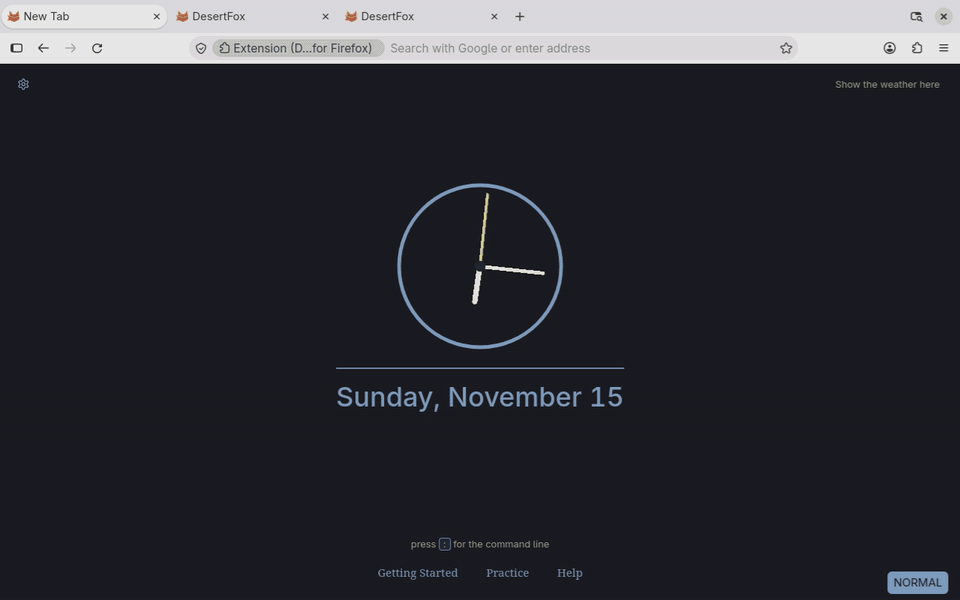
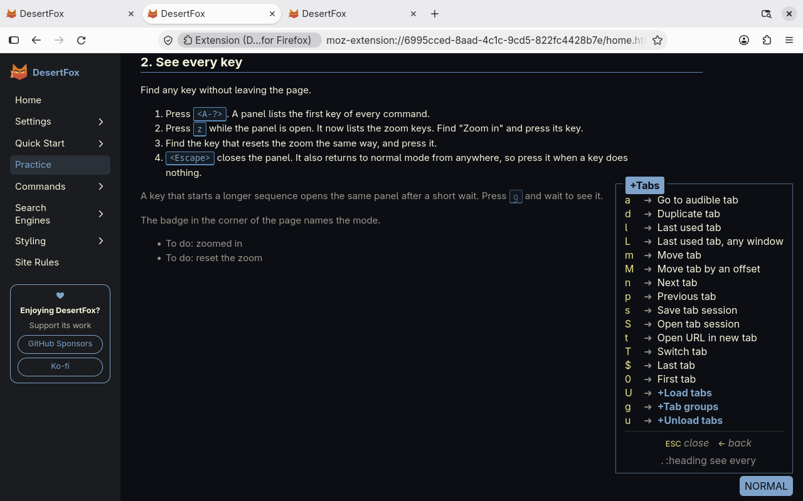
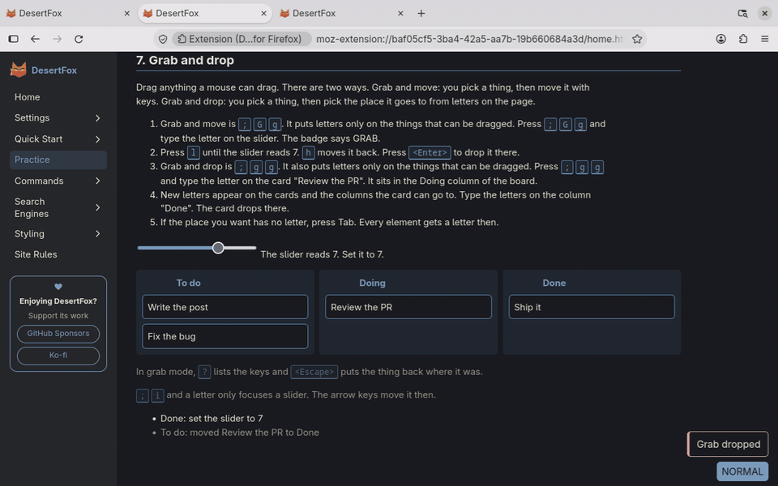

# 🦊 DesertFox

  
  
  
  

<i>Desert the mouse. The keys teach themselves.</i>

Vim keys for Firefox: link hints, a command line, keyboard drag and drop, and a popup that shows what every key does.

## 🦊 What it is

DesertFox puts Vim keys in Firefox. Press `f` and a short label appears next to every link and button. Type the label to click it. Press `j` and `k` to scroll, `/` to search the page, and `:` to run any command by name, with completion.

If you know Vim, you already know DesertFox. Modes, `hjkl`, `gg` and `G`, `yy`, counts, registers, marks, macros and `.` work as you expect. If you do not know Vim, the first day needs five keys. If you come from another keyboard tool for the browser, see [Switching](#switching-from-tridactyl-vimium-or-vim).

**The keys teach themselves.** Press a key that starts a longer sequence, such as `g`, and wait. A which-key popup (a popup that lists the keys that can follow and what each does) opens after a short pause. Press `<A-?>` in normal, hint, caret or visual mode to open it with the top-level keys of that mode. A Quick Start page opens when you install DesertFox, and a Practice page has 14 short lessons that you do on the page. Press `g?` to open the help page, which lists every key.

**Drag and drop from the keyboard.** Press `;Gg`, type the label on a slider or a card, and move it with `h` `j` `k` `l`. Press `;gg` to pick an element and then pick the place to drop it. Keyboard drag is built in and needs no script.

You can edit any text box in your own editor, such as Neovim: press `<C-o>` in insert mode. This needs the native host (see [Install](#-install)) and an `editor.toml` that names your editor (see [host/README.md](host/README.md)). Without it, `<C-o>` shows an error that says where to create the file.

## 🏆 Why DesertFox

- **You learn it as you go.** A popup shows the keys that can follow a key that starts a sequence. A Quick Start page and a Practice page teach the rest. [Details](docs/design.md#which-key).
- **You drag and drop without the mouse.** Grab a slider, a card or a list item with a hint and move it with keys. [Details](#-how-it-compares).
- **It checks what you give it.** A typo is an error with a message, never a silent no-op. [Details](docs/design.md#registry).
- **It stays light on every page.** The script on each page is small, and the heavy parts load on first use. [Details](docs/design.md#content-script-size).
- **It is always ready.** A page gets its keys within milliseconds of starting to load. [Details](docs/design.md#constraints-from-firefox).
- **It grows with you.** The first day needs a few keys. Macros, per-site rules and your own commands wait until you want them. See [Features](#-features).
- **It is safe by design.** DesertFox never runs the keys, commands or config lines you type as code, and its optional helper program takes a fixed set of requests. [Details](docs/design.md#decisions).
- **It is tested with real key presses.** A test suite presses real keys in a real Firefox.

**DesertFox stays alive.** Its background page is a persistent Manifest V2 page, so Firefox does not unload it on a timer and it is there for every key. Settings, marks and the compiled keymap live in extension storage, so a restart of the page keeps them. Temporary settings, private marks and other session state clear on an add-on reload or update, and a macro that is playing stops. On each page the content script starts at `document_start` and asks the background for the keymap. Keys work within milliseconds of a page starting to load. If Firefox drops Manifest V2 one day, a move to an event page changes the manifest and little else. State is already in storage.

## 📦 Install

> [!NOTE]
> DesertFox is not on addons.mozilla.org yet. Install the signed beta below.

DesertFox runs in Firefox on desktop. The native host is Linux only.

### Beta

A beta build is signed by Mozilla, built nightly from `main` and updates itself. Open the [latest beta](https://github.com/uhs-robert/desertfox/releases?q=prerelease%3Atrue) release, then open the `desertfox-<version>.xpi` file under Assets in Firefox. Firefox asks you to confirm the permissions, then adds the add-on. If Firefox asks for a restart, restart it. To pin the beta in a policy file, see [Release channels](docs/design.md#release-channels).

### Native host (optional)

The native host is a small Linux helper program. You do not need it. In the browser you can change settings with `:set` or on the settings page, edit the config files in the files editor, import and export a zip, and rebind keys.

Firefox does not let extensions read files or start programs, so the host adds three things: editing a text field in your own editor with `<C-o>` in insert mode, the `,f` keys that open Firefox pages, and config files in `~/.config/desertfox/` that `config.reload` reads.

To install it, run `:native.install` in DesertFox and paste the command it shows in a terminal. Then grant the `nativeMessaging` permission with the button on that page. See [host/README.md](host/README.md) for what the host can and cannot do, the config folder rule and the bridge setup.

### From source

See [AGENTS.md](AGENTS.md) for the build and install commands.

## 🚀 Try it

After you install DesertFox, the Quick Start page opens. It teaches scrolling, hints, the command line, the which-key popup, modes, page search, caret and visual mode, and help, with the keys read from your keymap. It also sits in the help sidebar.

Then open the Practice page from the help sidebar or the new tab page. It has 14 short lessons, from scrolling to keyboard drag and video. You do each task on the page, and the page ticks it off.

The first day needs five keys: `j` and `k` to scroll, `f` to click, `:` for the command line and `g?` for help. Press `g?`, `,h` or `<F1>` on a normal page to open the help page. Press `g` and wait: a short pause after a key that starts a sequence shows the keys that can follow. Press `<A-?>` to see every top-level key.

On a page where keys never reach DesertFox, such as an `about:` page or the PDF viewer, press `<A-j>` or `<A-k>` to switch to the next or previous tab.

## 🔍 How it compares

Power without a manual to memorize, a new browser to learn, or your Firefox add-ons to give up. Keyboard drag is built in and is DesertFox's alone among the extensions compared.

| Feature | DesertFox | Vimium | Vimium C | Tridactyl | qutebrowser (a whole browser, not an extension) |
| --- | --- | --- | --- | --- | --- |
| Hints with modifiers | ✅ | 🟡 | ✅ | ✅ | ✅ |
| Hint filters | ✅ | 🟡 | ✅ | ✅ | ✅ |
| Built-in keyboard drag (`;Gg`, `;gg`) | ✅ | ❌ | ❌ | ❌ | ❌ |
| [Built-in key integrations for specific sites](docs/compatibility.md) | ✅ | ❌ | ❌ | ❌ | ❌ |
| [Works in frames from other sites (sign-in popups, embeds)](docs/compatibility.md) | ✅ | 🟡 | 🟡 | ❌ | not checked |
| Hints for open menus and tooltips on very large pages | ✅ | ✅ | 🟡 skips them | ✅ | ✅ |
| Key popup (which-key) | ✅ | ❌ | ❌ | ❌ | ✅ |
| Generated help | ✅ | 🟡 | 🟡 | ✅ | ✅ |
| Command line with completion | ✅ | 🟡 | 🟡 | ✅ | ✅ |
| Caret mode | ✅ | 🟡 | 🟡 | ❌ | ✅ |
| Visual mode | ✅ | ✅ | ✅ | 🟡 | ✅ |
| Page search | ✅ | ✅ | ✅ | 🟡 uses the Firefox find bar | ✅ |
| Macros | ✅ | ❌ | ❌ | ❌ | ✅ |
| Per-site keys and settings | ✅ | keys only | 🟡 | ✅ | ✅ |
| Containers | ✅ | ❌ | 🟡 | ✅ | ❌ |
| Config file | ✅ | ❌ | ❌ | ✅ | ✅ |
| Helper program outside the browser | optional, fixed requests | ❌ | ❌ | optional, runs shell commands | n/a |
| Works with other Firefox add-ons | ✅ | ✅ | ✅ | ✅ | ❌ |
| Script loaded on every page and frame | 20.3 KB | 254 KB | 94 KB | 1.1 MB (top page only) | n/a |

✅ yes · ❌ no · 🟡 partial

Keyboard drag keys. `;` starts the hint keys, and `;g` and `;G` are modifiers that turn the hint into a grab. The letter after the modifier picks which elements get hints.
- `;Gg` grabs a draggable element and moves it with keys (grab and move). In grab mode, `h` `j` `k` `l` move it, `[` and `]` halve and double the step, `Enter` drops it and `Escape` cancels.
- `;gg` grabs a draggable element, then hints the page again so you pick the target to drop it on (grab and choose a target).
- The trailing `g` is the draggable filter: elements that declare drag, sliders, scrollbars and sortable handles. Another letter picks another filter, so `;ga` grabs any element and `;Ga` moves any element.
- `;w` swipes a carousel or slider with the same `h` `j` `k` `l` keys.
- A drag stays inside one frame, and a page that accepts only real mouse input ignores it.

Hints typically appear in under a tenth of a second, within the blink of an eye.

Sources, read in November 2026: each project's documentation, source code and shipped add-on.

- Vimium: [README](https://github.com/philc/vimium/blob/master/README.md).
- Vimium C: [README](https://github.com/gdh1995/vimium-c/blob/master/README.md) and the 2.12.3 add-on.
- Tridactyl: [command source](https://github.com/tridactyl/tridactyl/blob/master/src/excmds.ts) (`bindurl`, `seturl`, `exclaim`).
- Speed, coverage and drag checks: [performance comparison](tools/measure/rivals/README.md).
- qutebrowser: [command reference](https://github.com/qutebrowser/qutebrowser/blob/main/doc/help/commands.asciidoc).

> [!NOTE]
> The last row shows size, not page speed. The sizes are as shipped.
> DesertFox and Vimium C are minified, and Vimium and Tridactyl are not. DesertFox defers loading hint and caret code to first use.

<b>🧭 Where another tool fits better</b>

- You use Chrome, Edge or Safari. DesertFox runs on desktop Firefox only. Vimium and Vimium C cover the other browsers.
- You want keys on every page, with no exception. Only a browser built for the keyboard, such as qutebrowser, gives that. An extension cannot run on Firefox's own pages.
- You want to run shell commands or your own scripting language from the browser. Tridactyl allows both. DesertFox leaves them out on purpose.
- You want the smallest set of keys and nothing to configure. Vimium has the fewest commands, but you learn them from its help page. DesertFox shows the next keys in its which-key popup after a short pause.

<b>🔀 Switching from Tridactyl, Vimium or Vim</b>

Most keys work as you know them:

- `f` and `F` hint links, `j` and `k` scroll, `gg` and `G` jump to the top and bottom, and `H` and `L` go back and forward.
- `J` goes to the next tab and `K` to the previous one, which follows `j` and `k` going down and up in a vertical tab layout. Vimium has them the other way round. `gt` and `gT` go to the next and previous tab as Vimium users expect.
- `/` searches the page, with `n` and `N` for the next and previous match. `o` and `O` open an address, `yy` copies the page address and `T` lists your tabs.
- `:` opens a command line with completion. Counts, `.`, registers (`"ay`) and macros (`q` and `@`) work as in Vim.

Two keys differ from Vim: `v` puts a caret in the page and `V` starts a selection. The `:` line is a DesertFox command line, not Ex.

You gain:

- A which-key popup for the keys you forget, and a Practice page for the ones you never learned.
- Keyboard drag and drop, which neither Vimium nor Tridactyl has built in.
- Macros and caret mode, which Tridactyl lacks, and settings per site, where Vimium has keys only.
- A script of 20.3 KB on each page.

You lose:

- Shell commands and a scripting language. Tridactyl has both (see its command source above), and DesertFox leaves them out on purpose.
- DesertFox has no `bind` or `:source` command like Tridactyl's. Keys live in a `keymap.toml` file that DesertFox checks and applies with one key. Your own commands are snippets (JavaScript files from your own config folder, or an import you accept).

## ✨ Features

- Click anything with `f`, and scroll, search, select text and drag without the mouse.
- Run any command by name with `:`, with completion for every flag and value.
- Manage tabs, bookmarks, history, containers and tab sessions.
- Repeat yourself with `.`, macros, registers and marks.
- Control video and audio from the keyboard.
- Set keys and settings per site, and keep your config in files.

Open a group for the details. [docs/keymap.md](docs/keymap.md) lists every default key.

<b>🖱️ Move and click</b>

- Click anything: press `f`, then type the short label next to a link, button, input or image. `F` opens a link in a background tab.
- Narrow the labels by link text: press `/` in hint mode and type part of the text.
- Do more with a label: the `;` keys copy a link, a picture, an element's text, its CSS selector or its HTML, download a file, hover, double-click, focus, inspect in DevTools, or focus a frame.
- Drag and drop: `;Gg` grabs an element and moves it with `h` `j` `k` `l`, `;gg` grabs one and drops it on a target you pick, and `;w` swipes a carousel.
- Scroll with `j` and `k`, jump with `gg` and `G`, and go back and forward with `H` and `L`.
- Jump between headings with `sh`, and to the next or previous page with `]]` and `[[`.

<b>🔍 Find, select and copy</b>

- Search the page: `/` finds text as you type, with regular expressions, and `n` and `N` move between matches.
- Select text without the mouse: `v` puts a caret in the page and `V` starts a selection, both with Vim motions.
- Copy the page address with `yy`, or every link on the page with `yL`. Tracking parameters are dropped from copied addresses.
- Keep text in registers: `"ay` copies into register `a`, and `"app` opens it.

<b>🗂️ Tabs and windows</b>

- Switch, move, pin, mute, close and reopen tabs. `T` lists your tabs and filters as you type.
- Find anything: `,,` searches open tabs, bookmarks, history, quickmarks and closed tabs in one list.
- Save and reopen sets of tabs: `ts` saves the window as a named session and `tS` opens one.
- Free memory: unload tabs you are not using and load them again later.
- Reopen a page in a Firefox container, with keys you bind to your own containers.

<b>⌨️ Commands and search</b>

- Run commands by name: `:` opens a line that completes commands, flags, tabs, bookmarks, history and search engines.
- Open a page or search with `o`, or in a new tab with `O`.
- Search the web: bind a key to any search engine. An engine can read the page you are on, for example to search inside the current GitHub repository.
- Open Firefox's own pages, such as settings, add-ons and downloads, with the `,f` keys. They need the native host (see [Install](#-install)). Without it, DesertFox copies the address for you to paste.
- Open bookmarks, add them and file them in folders from the keyboard.

<b>🔁 Repeat and remember</b>

- Repeat the last command or typed text with `.`.
- Record a macro with `q` and a letter, and replay it with `@`.
- Mark a place on a page with `m` and return with `'`. A capital letter marks a page you can jump to from any tab.
- Save a page under one key with `M`, and open it with `go` or `gn`.

<b>🎬 Media</b>

- Play, pause, seek, change speed and volume, toggle captions, fullscreen and picture-in-picture from the keyboard.
- Press `aa` for a media mode with one-key controls. It starts by itself when a video goes fullscreen.
- Pick the video quality on sites whose player DesertFox knows. The `media_quality` setting sets a level for every site or for chosen sites, and it applies when a video loads. The default, `auto`, leaves the player to the site.

<b>🎨 Make it yours</b>

- Per-site rules: turn DesertFox off on a site, give some keys back to the page, bind keys for one site, or set zoom and other settings per site.
- Change settings in the browser with `:set` or on the settings page.
- Keep your keys, search engines and settings in TOML files. Edit them on the settings page or import a zip. With the native host, you can also keep them in `~/.config/desertfox/` and apply an edit with `config.reload`. DesertFox checks them and applies an edit with no restart.
- Add your own commands as snippets (JavaScript files from your own config folder, or an import you accept).
- Pick one of the built-in color themes, write your own, or restyle every surface with CSS.
- Firefox Color themes in the Oasis palettes live in [oasis.nvim](https://github.com/uhs-robert/oasis.nvim). For deeper desktop integration, see [oasis-dots](https://github.com/uhs-robert/oasis-dots), the setup for an Arch Linux Hyprland workstation.
- Use the new tab page for a clock, links, recent tabs and bookmarks.

## 🏜️ Known limits

- Plain keys never work on pages where Firefox blocks extensions: `about:` pages, the PDF viewer, reader view and addons.mozilla.org. The `df` keyword in the address bar and the `Alt` chords still work there.
- A plain key such as `J` is lost when it lands on a tab that has not started loading. [docs/firefox-behavior.md](docs/firefox-behavior.md#working-around-the-limits) has the PDF viewer setup and the tab switch detail.
- Keyboard drag sends synthetic input. A page that accepts only real mouse input ignores it, and a drag cannot leave its frame, tab or window.

## 🧭 Docs

- [docs/design.md](docs/design.md): architecture, scope and what is not yet built.
- [docs/keymap.md](docs/keymap.md): every default key.
- [docs/firefox-behavior.md](docs/firefox-behavior.md): what Firefox allows, measured.
- [src/README.md](src/README.md): a code map for contributors.

## License

[MPL 2.0](LICENSE).
